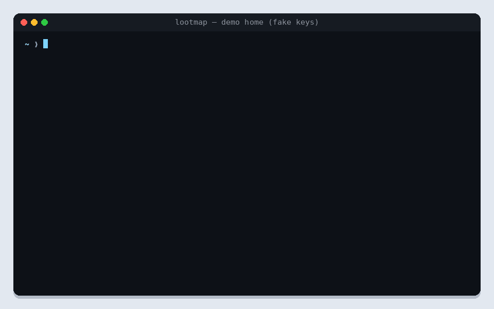
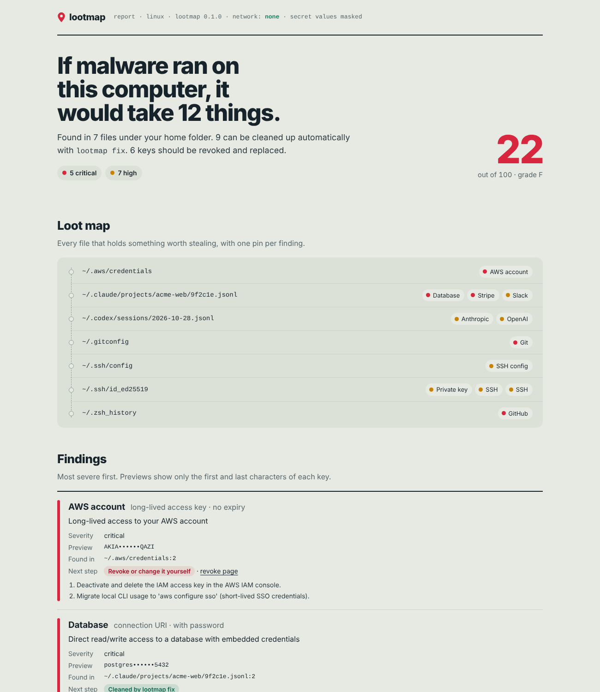

<div align="center">

# lootmap

**See your laptop the way malware does. Then fix it.**

lootmap shows what an infostealer or a Shai-Hulud-style worm would steal from your
machine if it ran right now: cloud keys, GitHub and npm tokens, SSH keys, and the
API keys your AI coding agent quietly saved to disk. Then it helps you lock it down.

[](https://github.com/lootmap-dev/lootmap/actions/workflows/ci.yml)
[](LICENSE)




<sub>Recorded against a demo home directory filled with fake keys. Nothing in this GIF is real.<br>
Try it in your browser on the <a href="https://lootmap-dev.github.io/lootmap/">project site</a>.</sub>

</div>

---

## Why

Supply-chain malware no longer needs to break into production. It runs on a developer
laptop during `npm install` and takes whatever is lying around:

- **Shai-Hulud** ran on package install, harvested `~/.aws/credentials`, `~/.npmrc`, GitHub
  tokens and SSH keys, and used the victims' own tokens to spread
  ([MITRE ATT&CK S9008](https://attack.mitre.org/software/S9008/)). Its second wave hit more
  than 25,000 developers in three days ([Hackmag](https://hackmag.com/news/shai-hulud-2-0)).
- The **hijacked Bitwarden CLI** package went further and also collected AI tool and MCP
  configuration files ([JFrog](https://research.jfrog.com/post/bitwarden-cli-hijack/)).
- **AI coding agents** write everything they read to plaintext transcripts on disk.
  Claude Code keeps them under `~/.claude/projects/` for 30 days by default
  ([guide](https://eseospace.com/blog/claude-code-secrets-management/)); one developer found
  62,311 likely secrets on a single laptop
  ([DEV](https://dev.to/beydemirfurkan/i-scanned-my-own-laptop-for-leaked-secrets-and-found-62311-of-them-3gp6)).

Secret scanners look at repositories. lootmap looks at **the machine**, tells you in plain
words what an attacker would walk away with, and fixes what can be fixed safely.

## Quick start

```bash
lootmap scan          # read-only: what would malware take?
lootmap fix --dry-run # show exactly what would change
lootmap fix --yes     # apply safe fixes (originals are backed up)
lootmap undo          # put everything back
```

A scan reads only your own files, takes seconds, and never prints a secret in full:

```text
lootmap 0.1.0 · linux · 12 probes · network: NONE

 IF MALWARE RAN ON THIS COMPUTER IT WOULD TAKE:

  ● AWS account        long-lived access key · no expiry      ~/.aws/credentials
  ● Database           connection URI · with password         ~/.claude/…/9f2c1e.jsonl
  ● Git                credential.helper = store              ~/.gitconfig
  ● GitHub             classic PAT · repo write               ~/.zsh_history
  ● Stripe             live secret key · full billing         ~/.claude/…/9f2c1e.jsonl
  ● Anthropic          API key                                ~/.codex/sessions/2026-10-28.jsonl
  ● OpenAI             API key                                ~/.codex/sessions/2026-10-28.jsonl
  ● Private key        PEM/OpenSSH private key                ~/.ssh/id_ed25519
  ● Slack              workspace token                        ~/.claude/…/9f2c1e.jsonl
  ● SSH config         ForwardAgent yes                       ~/.ssh/config
  ● SSH                key readable by other users            ~/.ssh/id_ed25519
  ● SSH                passphraseless key                     ~/.ssh/id_ed25519

 Score: 22/100 (F) · 5 critical · 7 high · 0 medium

 9 auto-fixable           -> lootmap fix
 6 keys need rotation     -> lootmap explain --rotate
```

## Install

> lootmap is in **pre-release**. Until the first tagged release, build it from source.

**From source** (Go 1.23+):

```bash
go install github.com/lootmap-dev/lootmap/cmd/lootmap@latest
```

**After the first release:**

```bash
brew install lootmap-dev/tap/lootmap                             # macOS / Linux
scoop bucket add lootmap https://github.com/lootmap-dev/scoop-bucket
scoop install lootmap                                            # Windows
```

Release archives are signed with keyless Sigstore cosign and ship with an SBOM and SLSA
provenance. Verify before you run:

```bash
cosign verify-blob \
  --certificate-identity-regexp="https://github.com/lootmap-dev/lootmap/.github/workflows/release.yml@refs/tags/v.*" \
  --certificate-oidc-issuer="https://token.actions.githubusercontent.com" \
  --signature checksums.txt.sig --certificate checksums.txt.pem checksums.txt
```

## What it checks

| Probe | Where it looks | What it finds | `lootmap fix` |
| --- | --- | --- | --- |
| `ai-transcripts` | Claude Code, Codex CLI, Gemini CLI, Cursor, Windsurf, Copilot Chat histories | Keys that leaked into chat and tool output | Redacts in place |
| `ai-config` | `~/.claude.json`, Claude Desktop, `~/.cursor/mcp.json`, Codex and VS Code MCP config | Plaintext tokens in MCP server definitions | Rotation guide |
| `cloud` | `~/.aws`, `~/.config/gcloud`, `~/.azure` | Long-lived AWS keys, GCP service accounts | Rotation guide |
| `git` | `~/.git-credentials`, git config (follows `include.path`), `gh` hosts | `credential.helper = store`, plaintext PATs | Switches to the OS keychain helper |
| `npm` | `~/.npmrc`, `~/.pypirc` | Publish tokens, install scripts enabled | Sets `ignore-scripts=true` |
| `ssh` | `~/.ssh` | Keys without a passphrase, `ForwardAgent yes`, loose permissions | `chmod 600`, `ForwardAgent no` |
| `shell-history` | zsh, bash, fish, PowerShell history | Tokens typed on the command line | Redacts in place |
| `shell-rc` | `.zshrc`, `.bashrc`, `.profile`, fish and PowerShell profiles | `export OPENAI_API_KEY=…` | Rotation guide |
| `dotenv` | `~/code`, `~/projects`, `~/dev`, `~/src`, `~/Documents/GitHub` (or `--roots`) | Production keys and database URLs in `.env*` | Rotation guide |
| `containers` | `~/.docker/config.json`, `~/.kube/config` | Registry passwords without `credsStore`, cluster tokens | `chmod 600` (Docker) |
| `iac` | Terraform Cloud and Pulumi credential files | Long-lived IaC tokens | `chmod 600` |
| `packages` | `package-lock.json`, `pnpm-lock.yaml`, `yarn.lock` | Known malicious package versions | Incident steps |

Run `lootmap doctor` to see which probes apply to your machine, and
`lootmap explain --rotate` for the exact page where each exposed key can be revoked.

## Safety model

lootmap reads the most sensitive files you have, so it is built to be boring and auditable:

- **No network.** `scan`, `fix`, `undo`, `doctor` and `check-packages` never open a
  connection. CI fails the build if `net/http` is imported anywhere outside `internal/osv`.
- **Secrets never leave memory in full.** A match is turned into a SHA-256 fingerprint and
  a masked preview (`ghp_••••••7c3b`) immediately. A dedicated test generates every
  supported key type and fails if any raw value reaches stdout, stderr, JSON or Markdown.
- **Scan is read-only.** Only `fix --yes` writes, and only after printing the full plan.
- **Every change is reversible.** Originals go to `~/.lootmap/backups/` (owner-only,
  deleted after 7 days); `lootmap undo` restores them byte for byte. Writes are atomic.
- **It will not touch a live session.** AI transcripts modified in the last 60 seconds are
  skipped unless you pass `--force`.
- **Out of scope by design:** browser password stores, OS keychains and crypto wallets are
  never read. No `sudo`, no telemetry, no account.

lootmap never revokes or deletes keys for you. Rotation happens in your provider's console;
`lootmap explain --rotate` links you straight there.

## HTML report

Prefer a browser view? One command writes a single, self-contained page:

```bash
lootmap scan --format html          # writes lootmap-report.html
```

The page has a loot map of every affected file, each finding with its masked preview and
next step, and the commands to fix it. It loads nothing from the internet (a strict
Content-Security-Policy blocks it) and contains masked values only, so you can hand it to
your security team. [See an example](https://lootmap-dev.github.io/lootmap/report-example.html).



## Use it in scripts and CI

```bash
lootmap scan --format json --output loot.json   # machine-readable, values masked
lootmap scan --min-severity high --strict       # exit 1 if anything high or critical is found
lootmap check-packages --strict                 # exit 1 on a known malicious package
```

## How it compares

| | lootmap | [bagel](https://boostsecurityio.github.io/bagel) | TruffleHog / Gitleaks | [agentsweep](https://pypi.org/project/agentsweep/) |
| --- | --- | --- | --- | --- |
| Scans the workstation, not just repos | Yes | Yes | Partly (filesystem mode) | AI histories only |
| Explains impact ("what you would lose") | Yes | No | No | No |
| Fixes with backup and undo | Yes | No | No | Redaction only |
| AI transcripts and MCP configs | Yes | Yes | No | Yes |
| Malicious package check | Yes | No | No | No |
| Single static binary | Yes | Yes | Yes | No (Python) |
| License | Apache-2.0 | GPL-3.0 | AGPL-3.0 / MIT | MIT |

These tools are complementary. Keep a pre-commit secret scanner on your repositories; run
lootmap on the machine those repositories live on.

## Project status

v0.1.0 is a **preview**. Before the first public release:

- Some AI tool paths are marked `# UNVERIFIED` in
  [`internal/probes/paths.yaml`](internal/probes/paths.yaml) and need confirming on real installs.
- The built-in malicious package list is a small placeholder; importing the OSV `MAL-` feed is next.
- `update-db` is disabled until a release signing key is in place.
- On Windows, permission fixes use `chmod`, which does not change ACLs yet.

Reports and pull requests for any of these are very welcome.

## Contributing

Supporting a new AI tool usually means one path entry in `internal/probes/paths.yaml` and a
fixture under `testdata/homes/`. See [CONTRIBUTING.md](CONTRIBUTING.md). Test fixtures use
`{{PLACEHOLDER}}` tokens, so no real-format secret is ever committed.

To re-record the demo above, see [docs/demo-src](docs/demo-src/README.md).

## Security

Found a way to make lootmap leak a secret or write outside its backup folder? Please
report it privately; see [SECURITY.md](SECURITY.md). The threat model is in
[THREAT-MODEL.md](THREAT-MODEL.md).

## License

[Apache-2.0](LICENSE)
